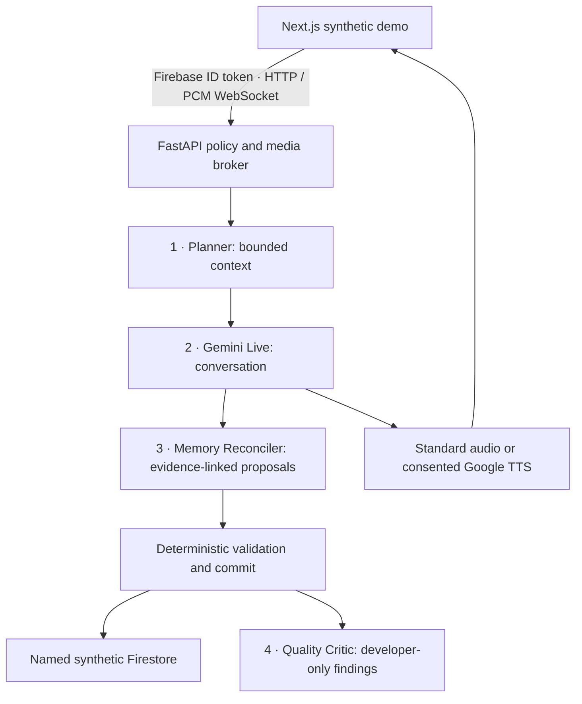

<p align="center">
  
</p>

<h1 align="center">Close to home, no matter where you roam</h1>

<p align="center">
  A voice-first AI companion exploring how thoughtful conversation can help
  families stay connected.
</p>

<p align="center">
  <a href="https://hugback.cloud.run">Hosted demo</a> ·
  <a href="#a-short-demo-tour">Demo tour</a> ·
  <a href="#run-locally">Run locally</a> ·
  <a href="docs/ARCHITECTURE.md">Architecture</a> ·
  <a href="docs/TESTING.md">Tests &amp; evaluation</a>
</p>

---

## Why HugBack?

When families live apart, a short, warm conversation can matter. HugBack explores
that moment: a companion that can talk naturally, draw on a few approved
background details, and gently follow up without turning every call into an
interview.

**HugBack is a companion, not a substitute for family.** It introduces itself as
HugBack, answers honestly when asked what it is, and must never claim to be the
child or a human family member—even when using an explicitly consented voice.

> **Hackathon scope:** this repository contains a working browser-based
> **synthetic simulator**, not a released real-family telephone service.
> Use fictional family/chat data only. The intended product is ordinary-phone
> conversation with Forms/Drive-assisted setup; parents would not need an app.
> Verified enrollment, production consent and PSTN integration remain release
> gates. The browser portal makes the prototype reviewable; it is not that
> production enrollment flow.

## What the prototype demonstrates

| Capability | What to look for |
| --- | --- |
| Real-time conversation | Gemini Live conversation through a FastAPI WebSocket broker, with browser microphone/playback and interruption handling. |
| Two voice options | A standard voice, or an adult's own explicitly consented Google replicated voice, assigned separately to each recipient. |
| Bounded background | Local chat preview followed by up to 24 attributed, permission-gated fictional excerpts—not a full-history upload or unlimited recall. |
| Independent recipients | Mother, Father and other recipients have separate background, memory, consent, calls and voice assignments. Sharing a voice never shares memory. |
| Four-stage workflow | A Planner, Live conversation agent, Memory Reconciler and Quality Critic; deterministic code—not a model—authorizes storage changes. |
| Signals back | Separately consented, short AI-generated future-call summaries with recipient/date filtering, never raw conversation transcripts. |
| Inspectable design | An architecture view, synthetic fixtures, regression tests and calibrated evaluation scenarios. |

Optional wellbeing estimates are explicitly AI-estimated and non-medical.
Summary email and brief topic notices exist behind separate backend
configuration; email is off by default, and provider acceptance is not proof of
inbox delivery. Post-call processing is **best effort**, not crash-durable.

## A short demo tour

1. Open the [hosted portal](https://hugback.cloud.run). Public demo
   admission uses Firebase anonymous authentication; it does not require a
   manually approved UID, but it still verifies tokens and isolates each owner.
   Keep the same browser and origin to retain that demo identity.
2. In **Family setup**, create fictional child/recipient profiles. Select a
   recipient explicitly and leave **standard voice** selected for the simplest
   walkthrough.
3. In **Background**, use the built-in synthetic example or the supplied
   [Mother](backend/hugback-test-mother.txt) /
   [Father](backend/hugback-test-father.txt) fictional chats. Map the speakers and
   give the simulated participant permissions before preparing background.
4. Choose **Test a call as [recipient]**. Review the Google-processing
   acknowledgement before starting. Model/audio use can incur charges.
5. End the call and wait for processing. A later call can use eligible,
   separately consented memory. If summary sharing was enabled **before** the
   call, open **Signals back** for its short summary; unavailable means
   unavailable, not a hidden transcript.
6. Switch to the other recipient to inspect their independent setup and history.
   The role selector is a simulator control, never speaker verification.

**Optional child voice:** use only your own adult voice and a separate spoken
consent recording. Explicitly acknowledge Google processing/billing, create and
enable the profile, then assign it to the intended recipient. No recording is
uploaded merely by selecting a file. Failed or expired custom voice never
silently falls back to standard voice.

The shared URL is publicly reachable, **not restricted to judges** and not a
spending cap. Hosted availability and provider eligibility depend on the
operator's deployed configuration; this README is not a live health check.

## How it works



**Models propose; policy code decides.** Identity, recipient membership, current
revision, leases, consent generations and source evidence are checked before
durable effects. Only Live owns the conversation; the other specialists do not
speak to the caller or choose whom data belongs to.

| Layer | Technology |
| --- | --- |
| Demo interface | Next.js 14, React 18, TypeScript, Tailwind CSS, Web Audio / AudioWorklets |
| Backend | Python 3.11+, FastAPI, Pydantic, Uvicorn |
| AI and speech | Google Gemini Live, structured Google model calls, Google Voices / streaming TTS |
| Hosted identity and state | Firebase Authentication, named Cloud Firestore, backend-only voice-key collection |
| Compute | Separate frontend and backend Cloud Run services |
| Local/offline adapters | SQLite and mocked providers; optional loopback Firestore emulator |

Full chat previews stay in browser IndexedDB. Private GCS retained-original
intake is a **separate, disabled-by-default internal module**. Cloud Tasks exists
for a legacy memory path; it does **not** make the demo's four-stage workflow or
email durable. See [architecture](docs/ARCHITECTURE.md) for these boundaries.

## Run locally

Prerequisites: **Python 3.11+**, **Node.js 20 LTS** and npm. Start from a fresh
clone; application commands run inside their respective directories.

```sh
git clone https://github.com/Khushi-Kasturiya/hugback-ai.git
cd hugback-ai/backend
python3 -m venv .venv
.venv/bin/python -m pip install -e .

# Local synthetic setup only; no cloud storage or credentials required.
HOST=127.0.0.1 PORT=8000 LOCAL_DEMO_ENABLED=true \
  HUGBACK_AUTH_MODE=development HUGBACK_DEMO_STORE=sqlite \
  .venv/bin/python -m app.main
```

In a second terminal, from the clone:

```sh
cd frontend
npm ci
cp -n .env.example .env.local
npm run dev
```

Open [local setup](http://127.0.0.1:3000/childportal). Keep one hostname throughout.
This starts the local interface and synthetic storage; it does **not** supply
Google model access. Starting a real model call requires an authorized
server-only `GEMINI_API_KEY` and model access. The optional workflow, extraction
and replicated-voice flags are documented in [development](docs/DEVELOPMENT.md).
Never put a backend credential in `NEXT_PUBLIC_*`.

For an existing checkout, review the private backend `.env` and shell variables
first: they may enable cloud services. Do not overwrite credentials or reuse a
hosted profile for an offline test.

## Verify without paid services

```sh
# From backend/ (virtual environment installed above)
.venv/bin/python -m evals.run --suite offline --output /tmp/hugback-offline-eval.json

# From frontend/
npm test
npm run typecheck
npm run build
```

The offline evaluator runs mocked backend regressions and calibrates the
conversation rubrics against known good/bad examples. Frontend tests cover
identity, recipient selection, audio, imports and summary-only history.
Use an isolated checkout for a production build if a dev server is running.

These checks **do not prove** real provider quality, voice likeness, cloud IAM,
email delivery or telephone behavior. Paid `models` and `live` suites require a
separate explicit opt-in; see [testing](docs/TESTING.md).

## Repository guide

```text
README.md                  Shared frontend + backend entry point
docs/
  ARCHITECTURE.md           Runtime, workflow and storage boundaries
  DEVELOPMENT.md            Local configuration and deployment cautions
  TESTING.md                Offline checks, demo acceptance and paid eval gates
  DATA_AND_SAFETY.md         Consent, retention, voice and internal intake
backend/
  app/                     API, audio broker, policy and storage
  tests/ · evals/           Regressions and synthetic model scenarios
  scripts/                 Explicit operator tools
  docs/examples/           Fictional intake fixtures (not extra guides)
frontend/
  src/ · public/           Demo interface, audio worklets and assets
  tests/                   Node-based regression tests
```

Scoped `AGENTS.md` files are retained as engineering safety instructions, not
duplicate setup guides. Dependencies, tests and Docker build contexts remain
separate. This submission repo is independent of the two repositories connected
to the existing deployed services; documentation cleanup here does not deploy
them. Any deployment migration needs a separate operator review.

**Before real-family use:** verified participant enrollment and consent,
telephone integration, durable jobs/delivery, access-rule/IAM validation,
complete erasure and provider-quality checks remain mandatory.
Read [data and safety](docs/DATA_AND_SAFETY.md) before extending the demo.

